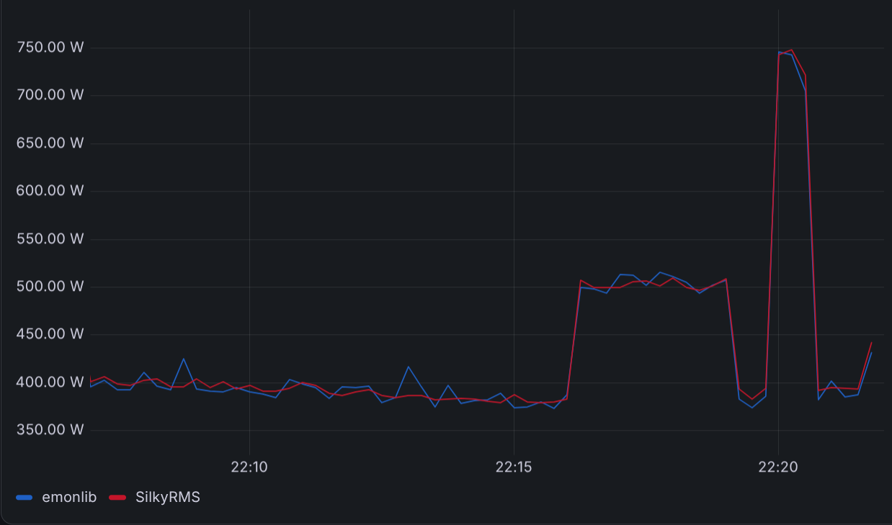
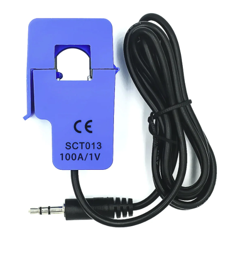
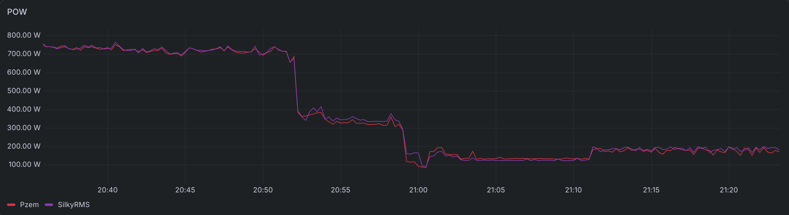

# Friendly Advice
If you are working on a power monitoring project, consider using the [PZEM-004T](https://www.google.com/search?q=pzem-004t) module instead, as it provides far more accurate readings.
This library is mostly useful if you are limited to a standalone SCT-013 (or similar) sensor.

# SilkyRMS

Power and current calculation for ESP32 using SCT-013-style sensors.

A high-performance, RTOS-aware AC signal RMS calculation library for ESP32 and modern dual-core microcontrollers. 

SilkyRMS continuously calculates True RMS current and power using high-speed integer accumulation and an Exponential Moving Average (EMA) DC offset tracker. It is designed to maximize the sample rate without starving RTOS background tasks or triggering watchdog panics.

[](https://registry.platformio.org/libraries/anha1/SilkyRMS)

## Core Mechanics

* **High-Speed Integer DSP Loop:** Avoids software-emulated floating-point math during the active sampling window. On an ESP32-S3, this yields approximately 89,000 samples over a 5-second measurement window (~17.8 kHz sampling rate).
* **Dynamic DC Offset Tracking:** Resistor tolerances and thermal drift cause the actual resting voltage of the circuit to deviate from the theoretical midpoint (e.g., 2048 on a 12-bit ADC). SilkyRMS seeds the offset with a calibration routine and continuously adjusts it with an EMA filter, keeping the AC waveform mathematically symmetric around it.
* **Prime Number Aliasing Protection:** System yields (required for FreeRTOS IDLE tasks and WiFi) introduce sampling blind spots. SilkyRMS uses prime-number modulo boundaries (e.g., yielding for 2ms every 199 samples) so that these blind spots drift steadily across the 50Hz/60Hz AC phase. This prevents systematic undersampling of wave peaks.
* **Variable ADC Resolution:** Calculates boundaries dynamically from the provided hardware bit depth.
* **ESP32 12-bit ADC Support:** see [BasicMeasurement (embedded ADC)](/examples/BasicMeasurement/BasicMeasurement.ino).
* **External ADC Support:** see [External ADC example](/examples/ExternalAdc/ExternalAdc.ino).

## Compatible Hardware

SilkyRMS is built for non-invasive AC Current Transformers (CT clamps) that output a low AC voltage proportional to the current flowing through the live wire.

It works with clamps such as the **SCT-013 series** (e.g., 30A/1V, 100A/1V). The library expects the AC signal from the clamp to be safely biased by a DC voltage divider before it enters the microcontroller's ADC pin.

## Hardware Wiring

The CT clamp outputs an AC waveform that swings both positive and negative. Because the ESP32 ADC cannot read negative voltages, the signal must be raised by a DC bias circuit (a voltage divider) to exactly half the ADC reference voltage (1.65V).

A bypass capacitor is required at the midpoint to stabilize the DC reference against noise and AC fluctuations.

       3.3V (ESP32)
        │
       [R1] 2kΩ
        │
        ├────────────────────── CT Clamp (Sleeve / Terminal 1)
        │
        ├──────────┐
        │          │
       [R2]       === C1 (10µF)
       2kΩ         │
        │          │
       GND        GND

    CT Clamp (Tip / Terminal 2) ───────── ESP32 ADC Pin (e.g., GPIO 4)

## Constructor Parameters

```cpp
SilkyRMS(
         uint8_t adc_resolution_bits = 12, 
         double v_ref = 3.3, 
         double volts_to_amps = 30.0, 
         double ac_voltage = 230.0);
```

* `adc_resolution_bits`: The bit depth of your MCU's ADC (e.g., 12 for most ESP32s).
* `v_ref`: The analog reference voltage powering your MCU (typically 3.3V).
* `volts_to_amps`: The ratio of your specific CT clamp. If your clamp outputs 1V at 30A, this value is `30.0`.
* `ac_voltage`: Your local grid mains voltage (e.g., `230.0` for EU, `120.0` for US). Used to calculate the final wattage.

## Usage Examples

See:
* [BasicMeasurement (embedded ADC)](/examples/BasicMeasurement/BasicMeasurement.ino) 
* [External ADC](/examples/ExternalAdc/ExternalAdc.ino).

## Calibration
The SilkyRMS vs emonlib chart above shows raw library readings. Using a PZEM module as a reference, it is clear that both libraries report a phantom
baseline power of about 100W caused by ADC and circuit noise. The noise level is also affected by power supply quality. For my setup, I arrived at the following calibration formula applied on top of the SilkyRMS readings:

```cpp
float power_w_calibrated = 1.02 * power_w - 100.;
```

With this correction applied, PZEM and SilkyRMS readings are nearly identical in practice:


Note that this formula works for my environment, but I'm not sure it's a generic adjustment — the same goes for the ~100W noise floor. That's why this correction is not built into the library. Treat my results as a reference point and choose the calibration that fits your own hardware.